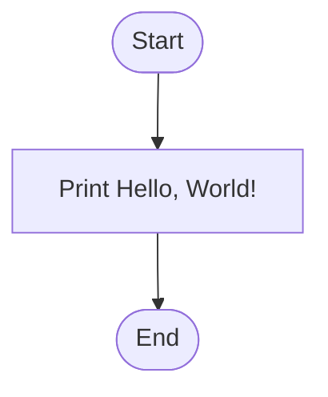

# Lab 01: Basic C Programming

## Question 1: Write a C program to print "Hello, World!"

### Flowchart



### Program

See [`01_hello_world.c`](01_hello_world.c).

### Input

No input required.

### Output

```text
Hello, World!
```

---

## Question 2: Write a C program to display your name, ID, department, and university name.

### Flowchart


### Program

See [`02_student_information.c`](02_student_information.c).

### Input

No input required.

### Output

```text
Name: Your Name
ID: Your Student ID
Department: CSE
University: First Capital University of Bangladesh
```

Replace the sample name and ID with your own details.

---

## Question 3: Write a C program to print multiple lines of text using printf().

### Flowchart


### Program

See [`03_multiple_lines.c`](03_multiple_lines.c).

### Input

No input required.

### Output

```text
Welcome to C Programming!
I am learning C language.
This is my Lab 01 program.
```

**Note:** The program links above assume your existing files have these exact filenames. If your filenames differ, update the links accordingly.
