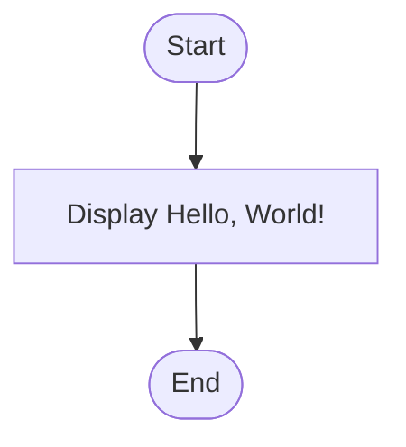
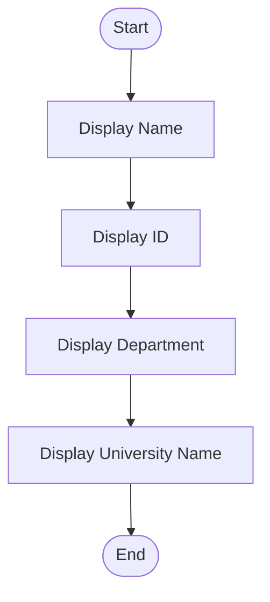
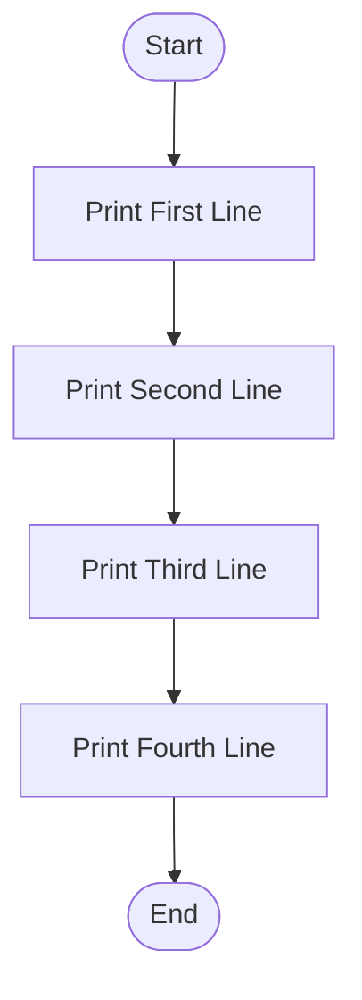

# Lab 01: Basic C Programming

## Program 01: Print Hello, World!

### Question:
Write a C program to print "Hello, World!".

### Flowchart:


### Input:
No input required.

### Output:
```text
Hello, World!
```

---

## Program 02: Display Personal Information

### Question:
Write a C program to display your name, ID, department, and university name.

### Flowchart:


### Input:
No input required. Personal information is predefined in the program.

### Output:
```text
Name: Your Name
ID: Your ID
Department: CSE
University: First Capital University of Bangladesh
```

---

## Program 03: Print Multiple Lines Using printf()

### Question:
Write a C program to print multiple lines of text using printf().

### Flowchart:


### Input:
No input required.

### Output:
```text
Hello!
Welcome to C Programming.
This is my third program.
Thank You!
```

---

## Lab 01 Conclusion

In this lab, we learned how to display text, print personal information, and print multiple lines using the printf() function in C.
