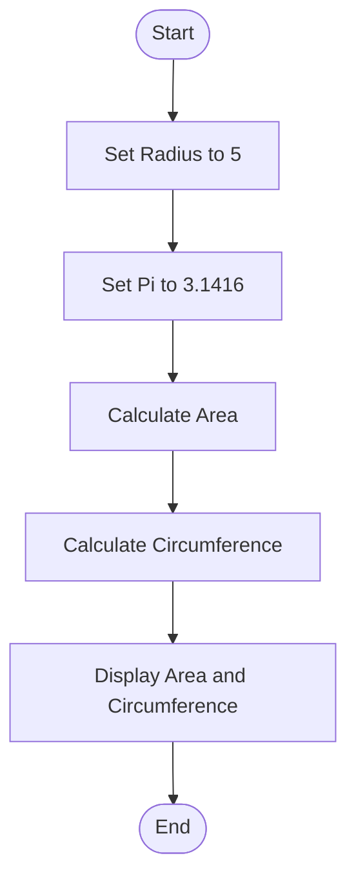
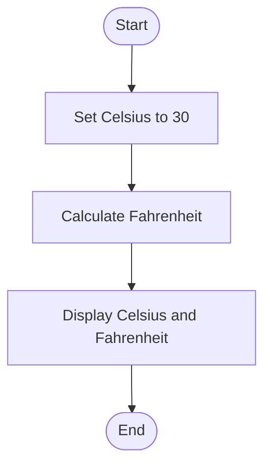
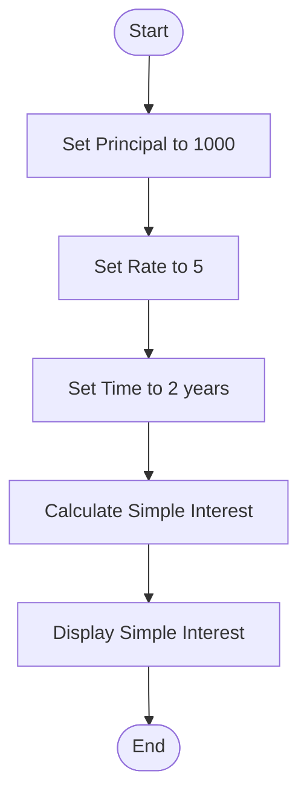
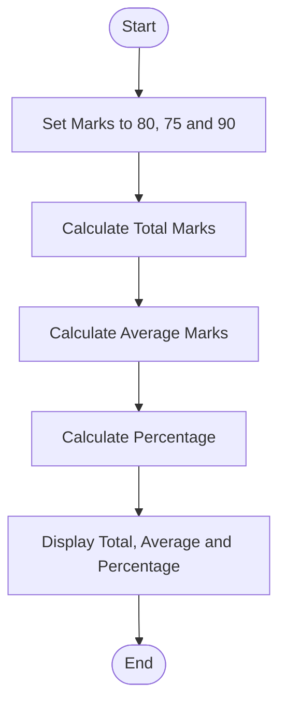

# Lab 05: Mathematical Programs in C

## 13. Calculate the Area and Circumference of a Circle

### Question
Write a C program to calculate the area and circumference of a circle.

### Flowchart



### Program
See [`13_circle.c`](https://github.com/tonmoy222/C-programming-lab-work-Batch-34/blob/main/Lab-05-Mathematical-Programs/13_circle.c).

### Input
```text
Radius = 5.0
Pi = 3.1416
```

### Output
```text
Area = 78.54
Circumference = 31.42
```


---

## 14. Convert Celsius to Fahrenheit

### Question
Write a C program to convert temperature from Celsius to Fahrenheit.

### Flowchart



### Program
See [`14_celsius_to_fahrenheit.c`](https://github.com/tonmoy222/C-programming-lab-work-Batch-34/blob/main/Lab-05-Mathematical-Programs/14_celsius_to_fahrenheit.c).

### Input
```text
Celsius = 30.0
```

### Output
```text
Celsius = 30.00
Fahrenheit = 86.00
```

---

## 15. Calculate Simple Interest

### Question
Write a C program to calculate simple interest using principal, rate, and time.

### Flowchart



### Program
See [`15_simple_interest.c`](https://github.com/tonmoy222/C-programming-lab-work-Batch-34/blob/main/Lab-05-Mathematical-Programs/15_simple_interest.c).

### Input
```text
Principal = 1000
Rate = 5
Time = 2 years
```

### Output
```text
Principal = 1000.00
Rate = 5.00%
Time = 2.00 years
Simple Interest = 100.00
```

---

## 16. Calculate Total Marks, Average Marks, and Percentage

### Question
Write a C program to calculate a student's total marks, average marks, and percentage in three subjects.

### Flowchart



### Program
See [`16_student_marks.c`](https://github.com/tonmoy222/C-programming-lab-work-Batch-34/blob/main/Lab-05-Mathematical-Programs/16_student_marks.c).

### Input
```text
Subject 1 = 80
Subject 2 = 75
Subject 3 = 90
Full Marks = 300
```

### Output
```text
Total Marks = 245.00
Average Marks = 81.67
Percentage = 81.67%
```


---

## Lab 05 Conclusion

In this lab, we practiced mathematical formulas, variables, constants, and arithmetic operators in C programming.
