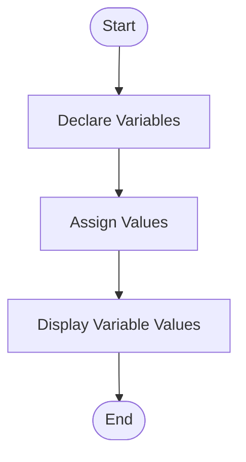
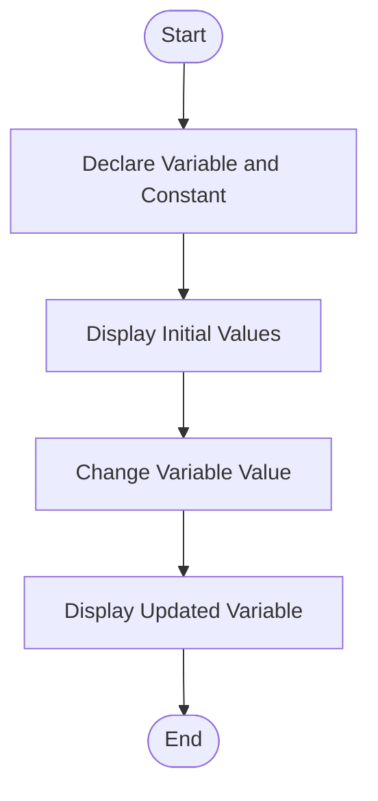
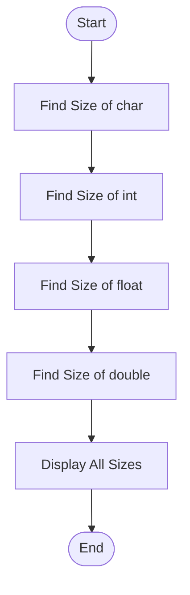

# Lab 02: Variables, Constants and Data Types

## Question 4: Write a C program to declare and display variables of different data types.

### Flowchart



### Program

See [`04_data_types.c`](04_data_types.c).

### Input

No input required.

### Output

```text
Age: 24
Height: 5.7
CGPA: 3.85
Grade: A
```

---

## Question 5: Write a C program to demonstrate the use of constants and variables.

### Flowchart



### Program

See [`05_constants_variables.c`](05_constants_variables.c).

### Input

No input required.

### Output

```text
Initial age: 24
Value of PI: 3.14159
Updated age: 25
```

---

## Question 6: Write a C program to display the size of different data types using sizeof().

### Flowchart



### Program

See [`06_sizeof.c`](06_sizeof.c).

### Input

No input required.

### Output

```text
Size of char: 1 byte(s)
Size of int: 4 byte(s)
Size of float: 4 byte(s)
Size of double: 8 byte(s)
```


---

