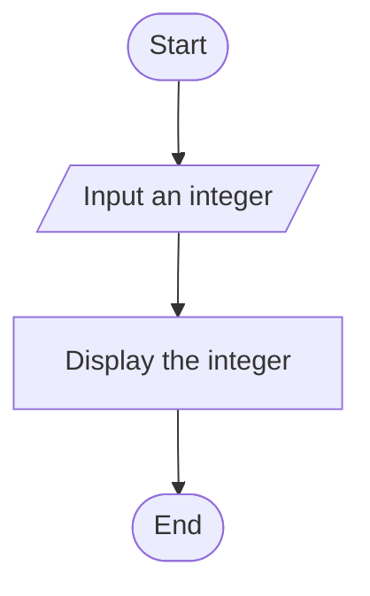
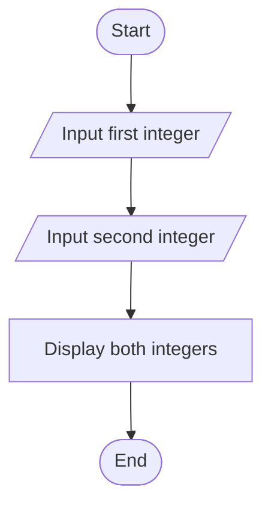
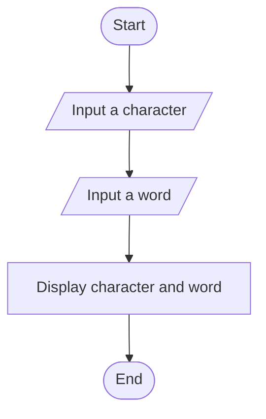

# Lab 03: Input and Output

## Question 7: Write a C program to take an integer as input and display it.

### Flowchart



### Program

See [`07_integer_input.c`](07_integer_input.c).

### Input

```text
25
```

### Output

```text
Enter an integer: 25
You entered: 25
```

---

## Question 8: Write a C program to take two integers as input and display them.

### Flowchart



### Program

See [`08_two_integers.c`](08_two_integers.c).

### Input

```text
10
20
```

### Output

```text
Enter the first integer: 10
Enter the second integer: 20
First integer: 10
Second integer: 20
```

---

## Question 9: Write a C program to take a character and a string as input and display them.

### Flowchart



### Program

See [`09_character_and_string.c`](09_character_and_string.c).

### Input

```text
A
Tonmoy
```

### Output

```text
Enter a character: A
Enter a word: Tonmoy
Character: A
Word: Tonmoy
```

