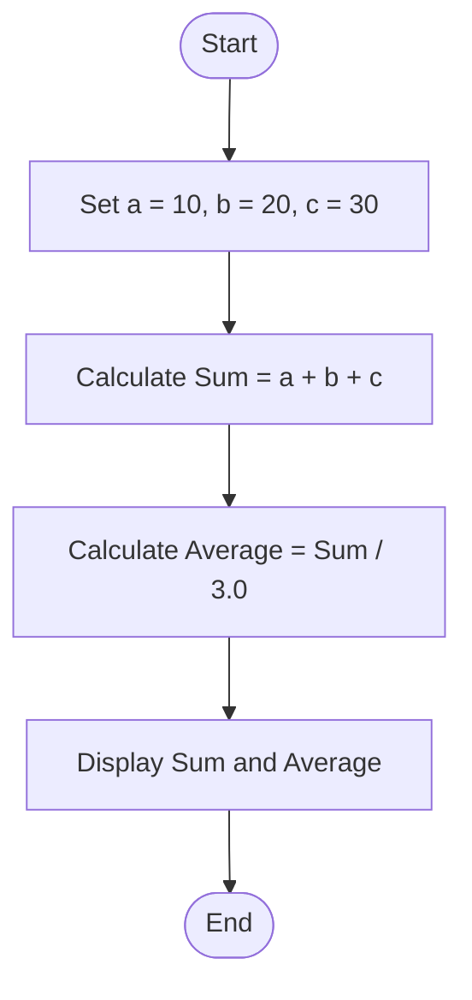
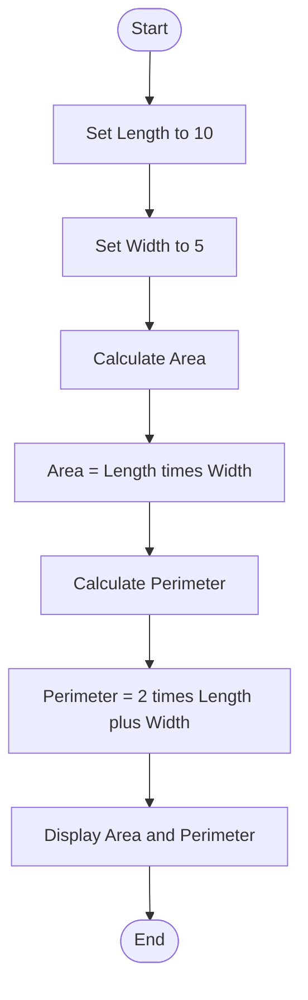

# Lab 04: Arithmetic Operators

## Question 10: Write a C program to perform addition, subtraction, multiplication, division, and modulus of two numbers.

### Flowchart


### Program

See [`10_arithmetic_operations.c`](10_arithmetic_operations.c).

### Input

No input required. The program uses fixed values: `a = 10` and `b = 3`.

### Output

```text id="ar10out"
Addition = 13
Subtraction = 7
Multiplication = 30
Division = 3.33
Modulus = 1
```

---

## Question 11: Write a C program to calculate the sum and average of three numbers.

### Flowchart



### Program

See [`11_sum_average.c`](11_sum_average.c).

### Input

No input required. The program uses fixed values: `10`, `20`, and `30`.

### Output

```text id="ar11out"
Sum = 60
Average = 20.00
```

---

## 12. Calculate the Area and Perimeter of a Rectangle

### Question
Write a C program to calculate the area and perimeter of a rectangle.

### Flowchart



### Program

**File:** `12_rectangle.c`

See [`12_rectangle.c`](https://github.com/tonmoy222/C-programming-lab-work-Batch-34/blob/main/Lab-04-Arithmetic-Operators/12_rectangle.c).


### Input

```text
Length = 10
Width = 5
```


### Output

```text
Area = 50
Perimeter = 30
```

### Calculation

- **Area** = Length × Width = 10 × 5 = 50
- **Perimeter** = 2 × (Length + Width) = 2 × (10 + 5) = 30


