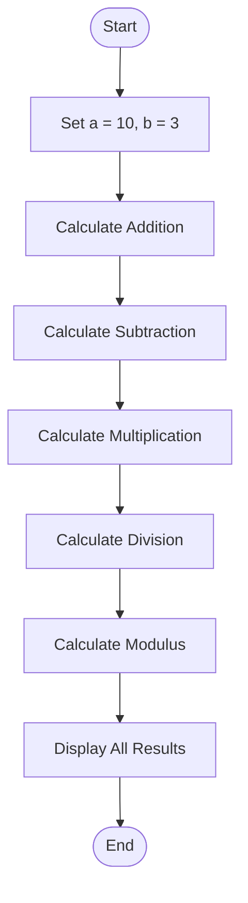

# Lab 04: Arithmetic Operators

## Question 10: Write a C program to perform addition, subtraction, multiplication, division, and modulus of two numbers.

### Flowchart



### Program

See [`10_arithmetic_operations.c`](10_arithmetic_operations.c).

### Input

No input required. The program uses fixed values: `a = 10` and `b = 3`.

### Output

```text id="ar10out"
Addition = 13
Subtraction = 7
Multiplication = 30
Division = 3.33
Modulus = 1
```

---

## Question 11: Write a C program to calculate the sum and average of three numbers.

### Flowchart


### Program

See [`11_sum_average.c`](11_sum_average.c).

### Input

No input required. The program uses fixed values: `10`, `20`, and `30`.

### Output

```text id="ar11out"
Sum = 60
Average = 20.00
```

---

## Question 12: Write a C program to calculate the area and perimeter of a rectangle.

flowchart TD
    A([Start]) --> B["Set Length = 10 and Width = 5"]
    B --> C["Calculate Area = Length times Width"]
    C --> D["Calculate Perimeter = 2 times the sum of Length and Width"]
    D --> E["Display Area and Perimeter"]
    E --> F([End])

