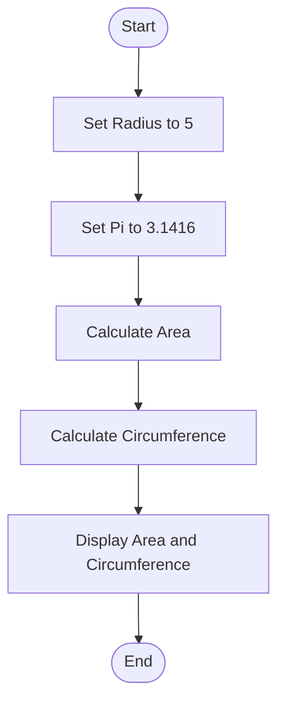
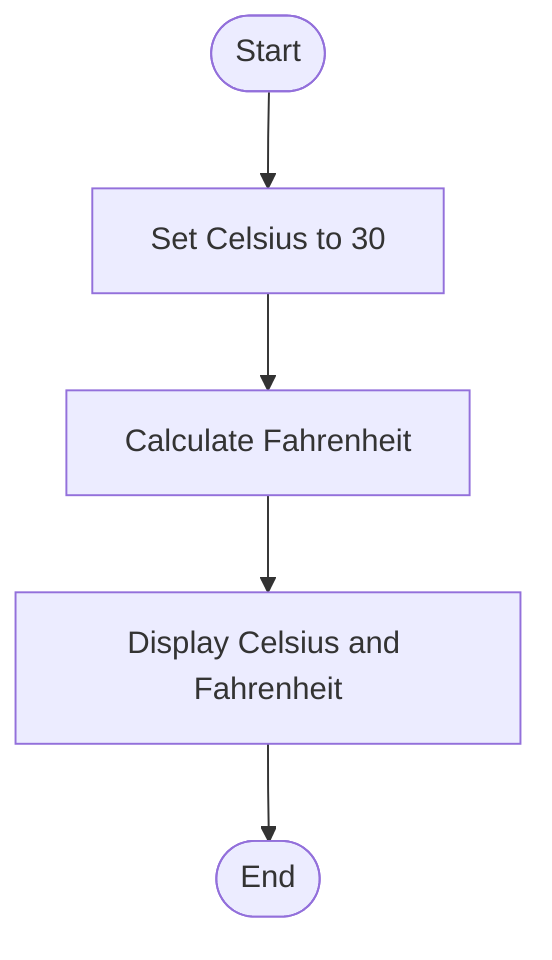
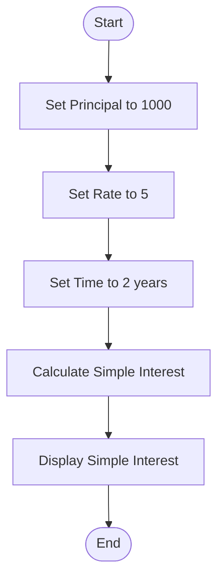
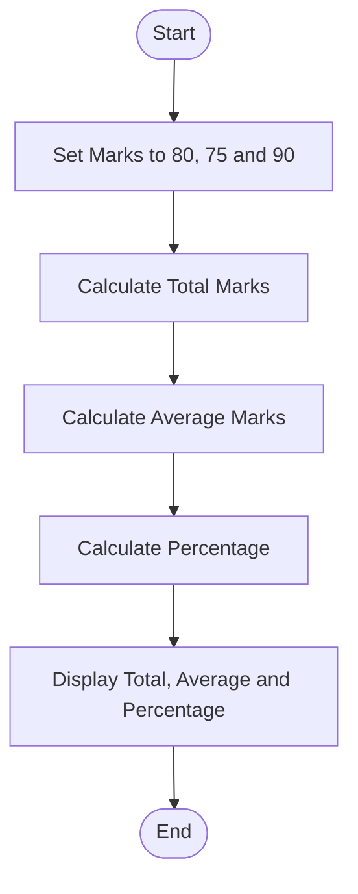

# Lab 05: Mathematical Programs in C

## 13. Calculate the Area and Circumference of a Circle

### Question
Calculate the area and circumference of a circle.

### Flowchart



### Input
```text
Radius = 5.0
Pi = 3.1416
```

### Output
```text
Area = 78.54
Circumference = 31.42
```

---

## 14. Convert Celsius to Fahrenheit

### Question
Convert temperature from Celsius to Fahrenheit.

### Flowchart



### Input
```text
Celsius = 30.0
```

### Output
```text
Celsius = 30.00
Fahrenheit = 86.00
```

---

## 15. Calculate Simple Interest

### Question
Calculate simple interest using principal, rate, and time.

### Flowchart



### Input
```text
Principal = 1000
Rate = 5
Time = 2 years
```

### Output
```text
Principal = 1000.00
Rate = 5.00%
Time = 2.00 years
Simple Interest = 100.00
```


---

## 16. Calculate Total Marks, Average Marks, and Percentage

### Question
Calculate a student's total marks, average marks, and percentage in three subjects. Each subject carries 100 marks.

### Flowchart



### Input
```text
Subject 1 = 80
Subject 2 = 75
Subject 3 = 90
Full Marks = 300
```

### Output
```text
Total Marks = 245.00
Average Marks = 81.67
Percentage = 81.67%
```
