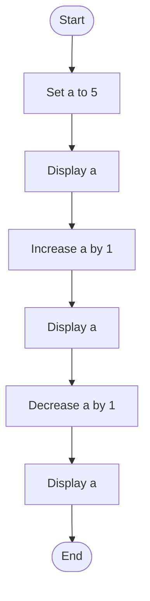
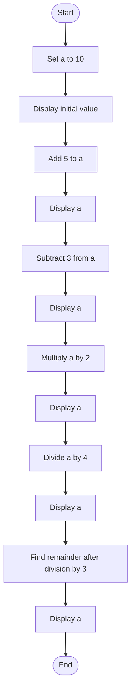
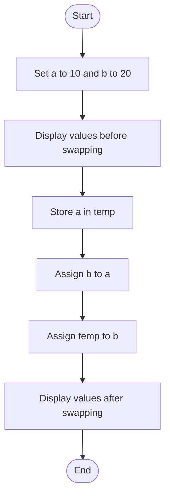

# Lab 06: Increment, Decrement and Assignment Operators

This lab demonstrates increment and decrement operators, compound assignment operators, and swapping two numbers using a third variable in C.

---

## 17. Increment and Decrement Operators

### Question

Write a C program to demonstrate the use of increment and decrement operators.

### Flowchart



### Program

**File:** `17_increment_decrement.c`

See [`17_increment_decrement.c`](./17_increment_decrement.c).

### Input

No user input is required. The initial value of `a` is 5.

### Output

```text
a = 5
After increment = 6
After decrement = 5
```

### Summary

This program demonstrates how increment and decrement operators increase or decrease a variable's value by one.

---

## 18. Compound Assignment Operators

### Question

Write a C program to demonstrate the use of compound assignment operators.

### Flowchart



### Program

**File:** `18_compound_assignment.c`

See [`18_compound_assignment.c`](./18_compound_assignment.c).

### Input

No user input is required. The initial value of `a` is 10.

### Output

```text
Initial value = 10
After += 5: 15
After -= 3: 12
After *= 2: 24
After /= 4: 6
After %= 3: 0
```

### Summary

This program demonstrates the compound assignment operators `+=`, `-=`, `*=`, `/=`, and `%=` in C.

---

## 19. Swap Two Numbers Using a Third Variable

### Question

Write a C program to swap two numbers using a third variable.

### Flowchart



### Program

**File:** `19_swap_two_numbers.c`

See [`19_swap_two_numbers.c`](./19_swap_two_numbers.c).

### Input

No user input is required. The initial values are `a = 10` and `b = 20`.

### Output

```text
Before swapping:
a = 10
b = 20
After swapping:
a = 20
b = 10
```

### Summary

This program swaps the values of two variables using a temporary variable.

---

## Lab 06 Conclusion

In this lab, we learned how to:

- Use increment and decrement operators.
- Apply compound assignment operators.
- Swap two numbers using a temporary variable.
- Understand how variable values change during program execution.
