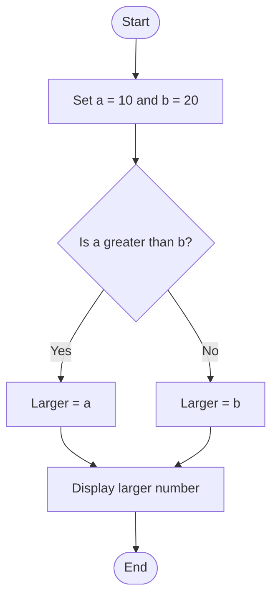
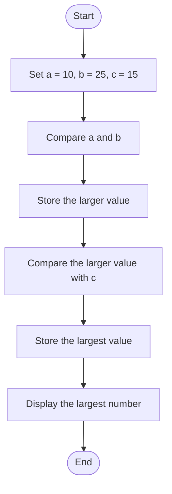
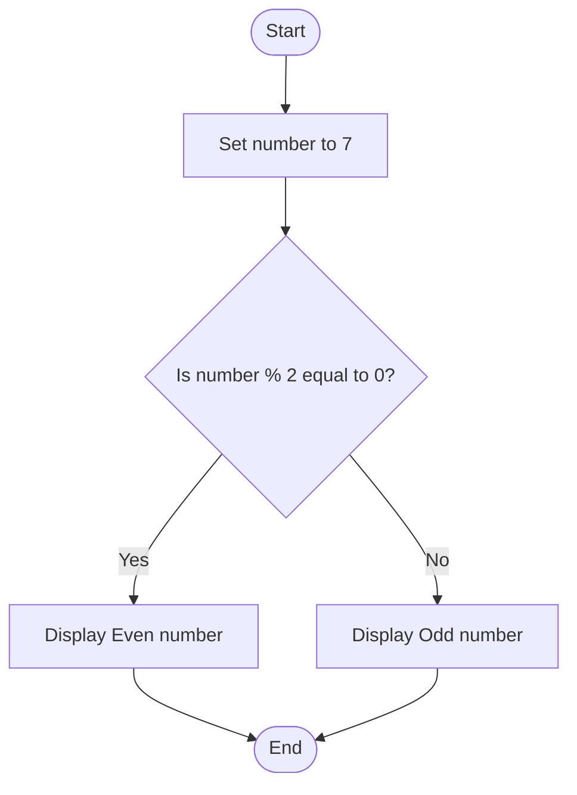

# Lab 07: Conditional Operator

This lab demonstrates how to use the conditional operator in C to make decisions.

---

## 20. Find the Larger of Two Numbers

### Question
Write a C program to find the larger of two numbers using the conditional operator.

### Flowchart



### Program

**File:** `20_larger_of_two.c`

See [`20_larger_of_two.c`](./20_larger_of_two.c).

### Input
No user input is required. The values are predefined as a = 10 and b = 20.

### Output

```text
Larger number = 20
```

### Summary
This program uses the conditional operator to find the larger of two numbers.

---

## 21. Find the Largest of Three Numbers

### Question
Write a C program to find the largest of three numbers using the conditional operator.

### Flowchart



### Program

**File:** `21_largest_of_three.c`

See [`21_largest_of_three.c`](./21_largest_of_three.c).

### Input
No user input is required. The values are predefined as a = 10, b = 25, and c = 15.

### Output

```text
Largest number = 25
```

### Summary
This program uses the conditional operator to find the largest among three numbers.

---

## 22. Check Whether a Number Is Even or Odd

### Question
Write a C program to check whether a number is even or odd using the conditional operator.

### Flowchart



### Program

**File:** `22_even_or_odd.c`

See [`22_even_or_odd.c`](./22_even_or_odd.c).

### Input
No user input is required. The number is predefined as 7.

### Output

```text
Odd number
```

### Summary
This program uses the modulus operator and conditional operator to check whether a number is even or odd.

---

## Lab 07 Conclusion

In this lab, we learned how to use the conditional operator (?:) to find the larger of two numbers, the largest of three numbers, and check whether a number is even or odd.
