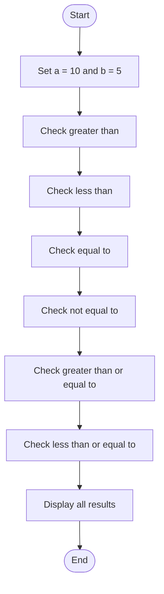
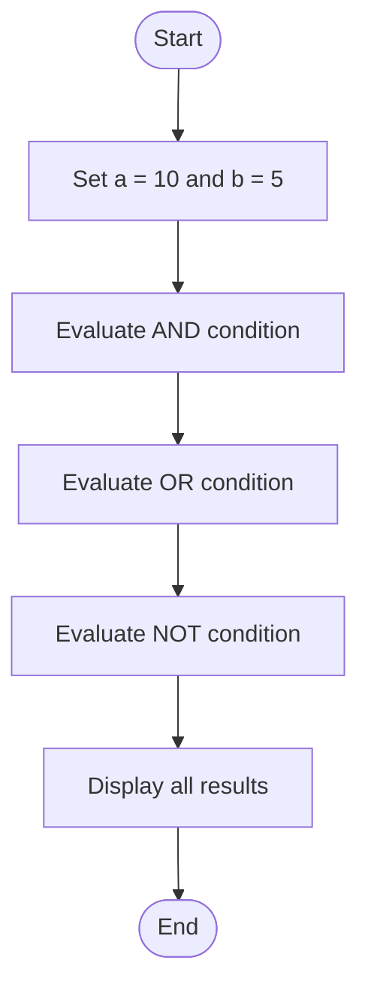
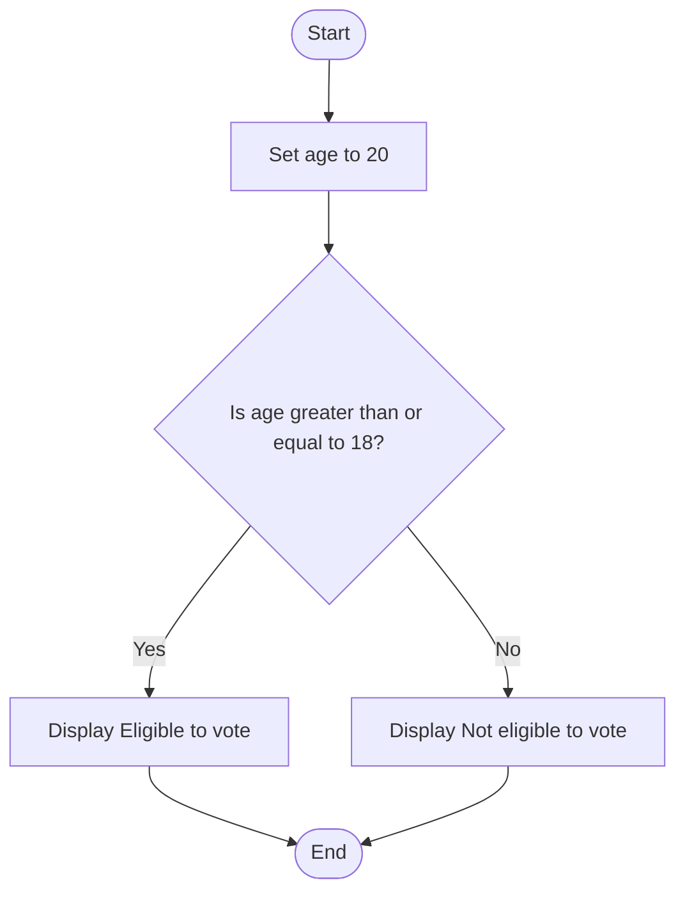

# Lab 08: Relational and Logical Operators

This lab demonstrates relational operators, logical operators, and voting eligibility using C.

---

## 23. Demonstrate Relational Operators

### Question
Write a C program to demonstrate the use of relational operators.

### Flowchart



### Program

**File:** `23_relational_operators.c`

See [`23_relational_operators.c`](./23_relational_operators.c).

### Input
No user input is required. The values are predefined as a = 10 and b = 5.

### Output

```text
a > b = 1
a < b = 0
a == b = 0
a != b = 1
a >= b = 1
a <= b = 0
```

### Summary
This program demonstrates six relational operators in C.

---

## 24. Demonstrate Logical Operators

### Question
Write a C program to demonstrate logical AND, OR, and NOT operators.

### Flowchart



### Program

**File:** `24_logical_operators.c`

See [`24_logical_operators.c`](./24_logical_operators.c).

### Input
No user input is required. The values are predefined as a = 10 and b = 5.

### Output

```text
AND = 1
OR = 1
NOT = 0
```

### Summary
This program demonstrates the logical AND (&&), OR (||), and NOT (!) operators in C.

---

## 25. Check Voting Eligibility

### Question
Write a C program to check whether a person is eligible to vote.

### Flowchart



### Program

**File:** `25_voting_eligibility.c`

See [`25_voting_eligibility.c`](./25_voting_eligibility.c).

### Input
No user input is required. The age is predefined as 20.

### Output

```text
Eligible to vote
```

### Summary
This program uses an if-else statement and a relational operator to check voting eligibility.

---

## Lab 08 Conclusion

In this lab, we learned how to use relational operators, logical operators, and conditional statements in C programming.
