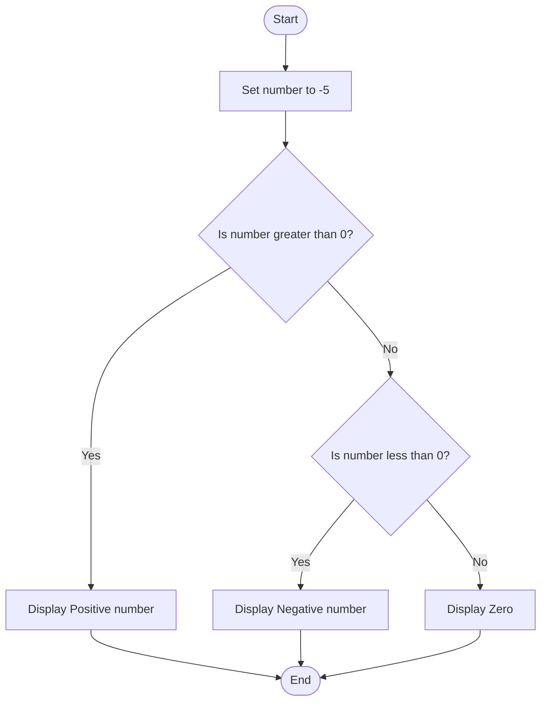
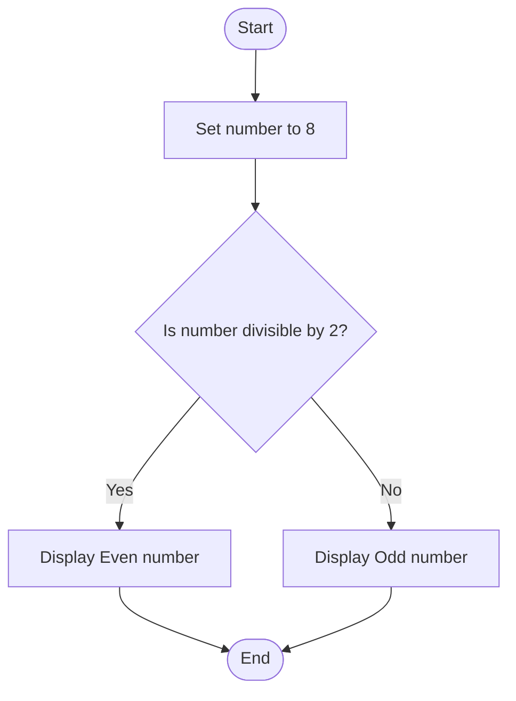
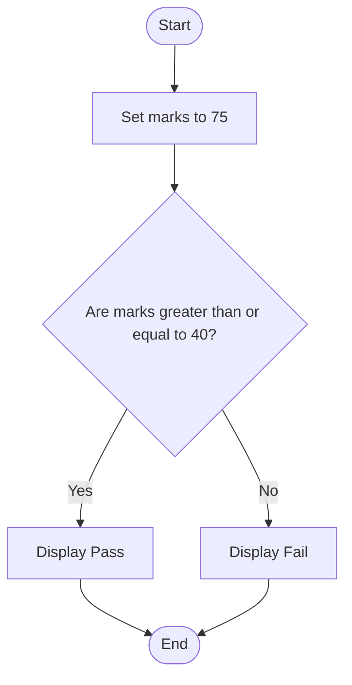

# Lab 09: if Statement

This lab demonstrates the use of if statements in C programming.

---

## 26. Check Positive, Negative, or Zero

### Question
Write a C program to check whether a number is positive, negative, or zero.

### Flowchart



### Program

**File:** `26_positive_negative_zero.c`

See [`26_positive_negative_zero.c`](./26_positive_negative_zero.c).

### Input
No user input is required. The number is predefined as -5.

### Output

```text
Negative number
```

### Summary
This program uses if statements to check whether a number is positive, negative, or zero.

---

## 27. Check Whether a Number Is Even or Odd

### Question
Write a C program to check whether a number is even or odd.

### Flowchart



### Program

**File:** `27_even_or_odd.c`

See [`27_even_or_odd.c`](./27_even_or_odd.c).

### Input
No user input is required. The number is predefined as 8.

### Output

```text
Even number
```

### Summary
This program uses if statements and the modulus operator to check whether a number is even or odd.

---

## 28. Check Student Pass or Fail

### Question
Write a C program to check whether a student has passed or failed based on marks.

### Flowchart



### Program

**File:** `28_pass_or_fail.c`

See [`28_pass_or_fail.c`](./28_pass_or_fail.c).

### Input
No user input is required. Marks are predefined as 75.

### Output

```text
Pass
```

### Summary
This program uses if statements to determine whether a student has passed or failed, assuming 40 is the passing mark.

---

## Lab 09 Conclusion

In this lab, we learned how to use if statements to check number types, identify even and odd numbers, and determine whether a student has passed or failed.
