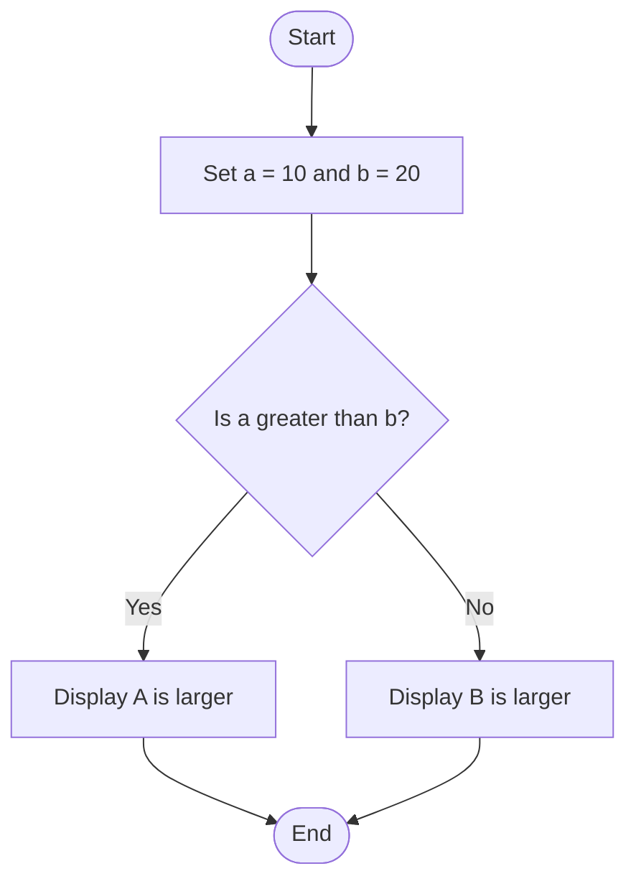
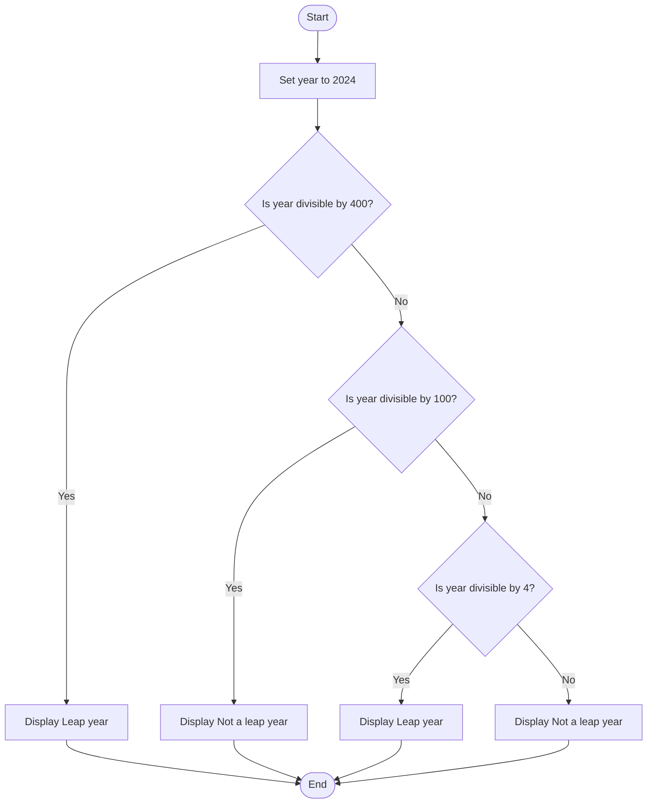
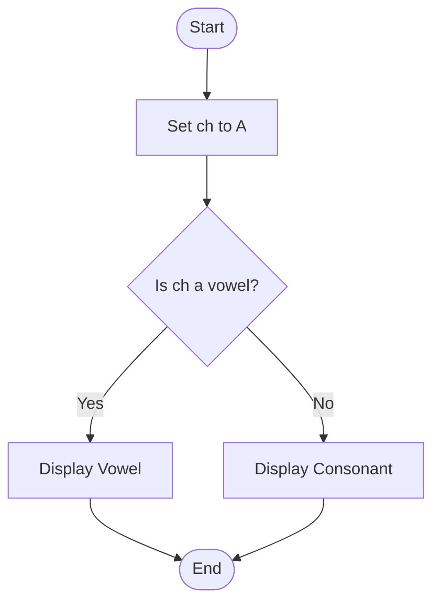

# Lab 10: if-else Statement

This lab demonstrates the use of if-else statements in C programming.

---

## 29. Find the Larger of Two Numbers

### Question
Write a C program to find the larger of two numbers using if-else.

### Flowchart



### Program

**File:** `29_larger_of_two.c`

See [`29_larger_of_two.c`](./29_larger_of_two.c).

### Input
No user input is required. The values are predefined as a = 10 and b = 20.

### Output

```text
B is larger
```

### Summary
This program uses an if-else statement to find the larger of two numbers.

---

## 30. Check Whether a Year Is a Leap Year

### Question
Write a C program to check whether a year is a leap year or not.

### Flowchart



### Program

**File:** `30_leap_year.c`

See [`30_leap_year.c`](./30_leap_year.c).

### Input
No user input is required. The year is predefined as 2024.

### Output

```text
Leap year
```

### Summary
This program uses conditional statements and the modulus operator to check whether a year is a leap year.

---

## 31. Check Whether a Character Is a Vowel or Consonant

### Question
Write a C program to check whether a character is a vowel or consonant.

### Flowchart



### Program

**File:** `31_vowel_or_consonant.c`

See [`31_vowel_or_consonant.c`](./31_vowel_or_consonant.c).

### Input
No user input is required. The character is predefined as A.

### Output

```text
Vowel
```

### Summary
This program uses an if-else statement and logical OR operators to check whether a character is a vowel or consonant.

---

## Lab 10 Conclusion

In this lab, we learned how to use if-else statements to compare numbers, check leap years, and identify vowels and consonants.
