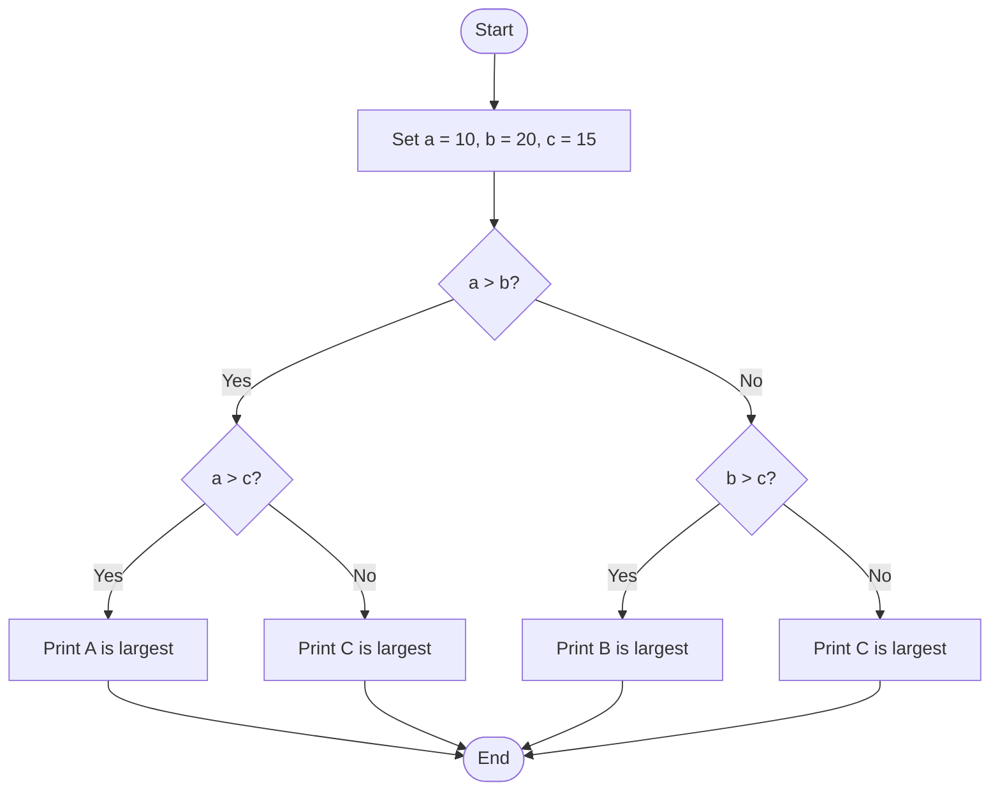
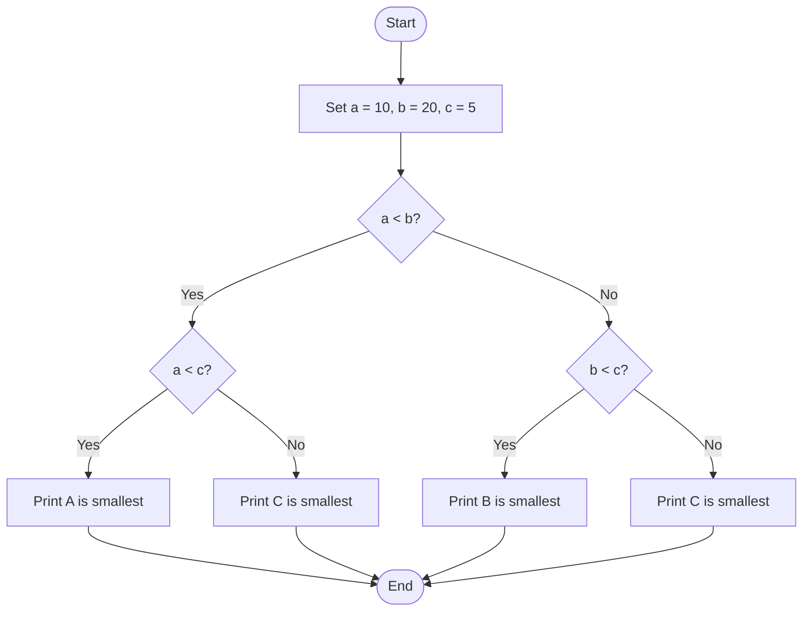
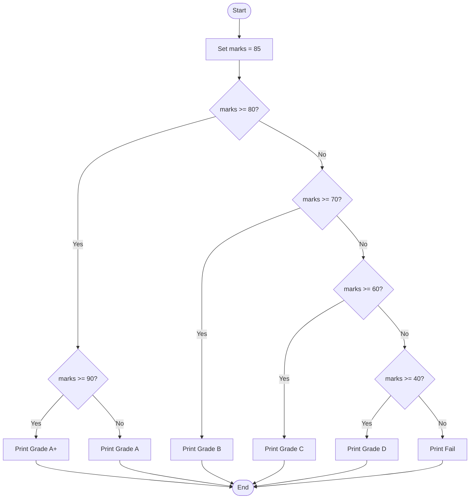

# Lab 11: Nested if Statements in C

## Program 32: Find the Largest of Three Numbers

### Question
Write a C program to find the largest of three numbers using nested if statements.

### Flowchart



### Program

**File:** 32_largest_nested_if.c

See [`32_largest_nested_if.c`](./32_largest_nested_if.c).

```c
#include <stdio.h>

int main()
{
    int a = 10, b = 20, c = 15;

    if (a > b)
    {
        if (a > c)
            printf("A is largest\n");
        else
            printf("C is largest\n");
    }
    else
    {
        if (b > c)
            printf("B is largest\n");
        else
            printf("C is largest\n");
    }

    return 0;
}
```

### Input
No user input is required. The values are predefined.

### Output

```text
B is largest
```

### Summary
This program uses nested if statements to find the largest of three numbers.

---

## Program 33: Find the Smallest of Three Numbers

### Question
Write a C program to find the smallest of three numbers using nested if statements.

### Flowchart



### Program

**File:** 33_smallest_nested_if.c

See [`33_smallest_nested_if.c`](./33_smallest_nested_if.c).

```c
#include <stdio.h>

int main()
{
    int a = 10, b = 20, c = 5;

    if (a < b)
    {
        if (a < c)
            printf("A is smallest\n");
        else
            printf("C is smallest\n");
    }
    else
    {
        if (b < c)
            printf("B is smallest\n");
        else
            printf("C is smallest\n");
    }

    return 0;
}
```

### Input
No user input is required. The values are predefined.

### Output

```text
C is smallest
```

### Summary
This program uses nested if statements to find the smallest of three numbers.

---

## Program 34: Determine a Student's Grade Using Nested if

### Question
Write a C program to determine a student's grade based on marks using nested if statements.

### Flowchart



### Program

**File:** 34_student_grade_nested_if.c

See [`34_student_grade_nested_if.c`](./34_student_grade_nested_if.c).

```c
#include <stdio.h>

int main()
{
    int marks = 85;

    if (marks >= 80)
    {
        if (marks >= 90)
            printf("Grade A+\n");
        else
            printf("Grade A\n");
    }
    else
    {
        if (marks >= 70)
            printf("Grade B\n");
        else
        {
            if (marks >= 60)
                printf("Grade C\n");
            else
            {
                if (marks >= 40)
                    printf("Grade D\n");
                else
                    printf("Fail\n");
            }
        }
    }

    return 0;
}
```

### Input
No user input is required. The marks are predefined as 85.

### Output

```text
Grade A
```

### Summary
This program uses nested if statements to assign a grade based on the student's marks.

---

## Conclusion

In this lab, we practiced nested if statements in C to find the largest number, find the smallest number, and determine a student's grade.
