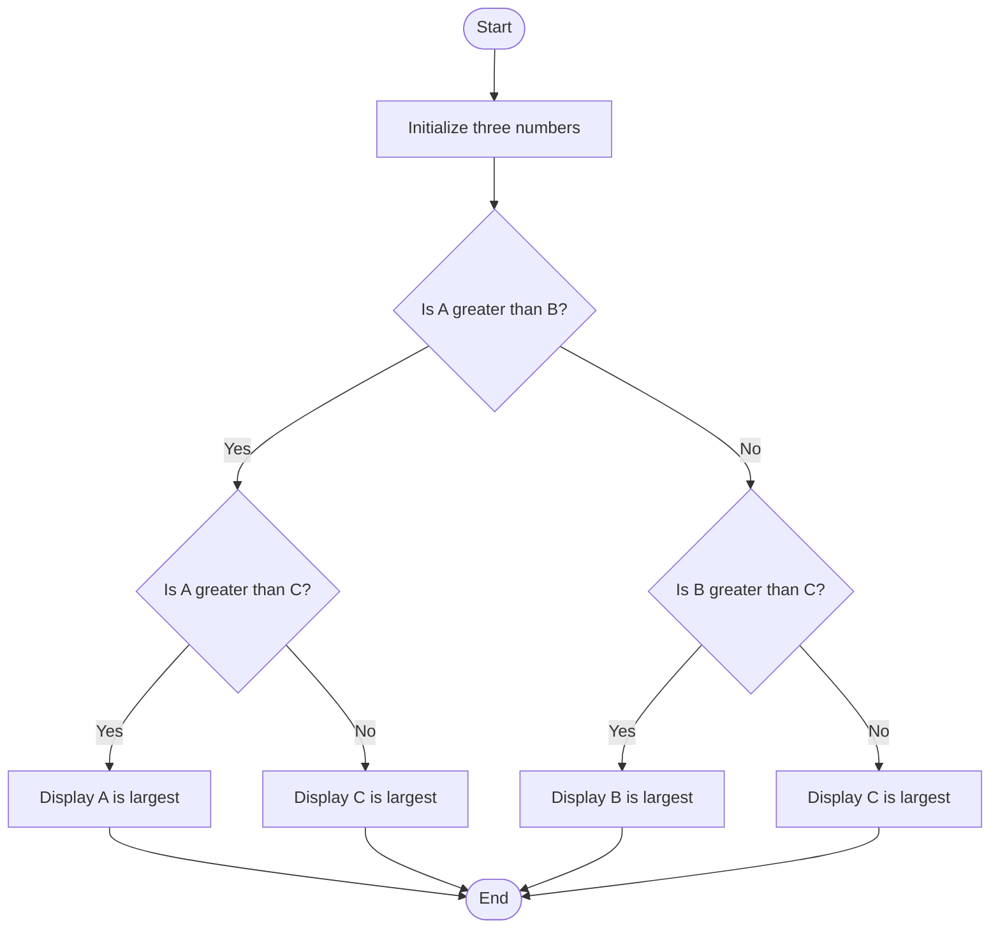
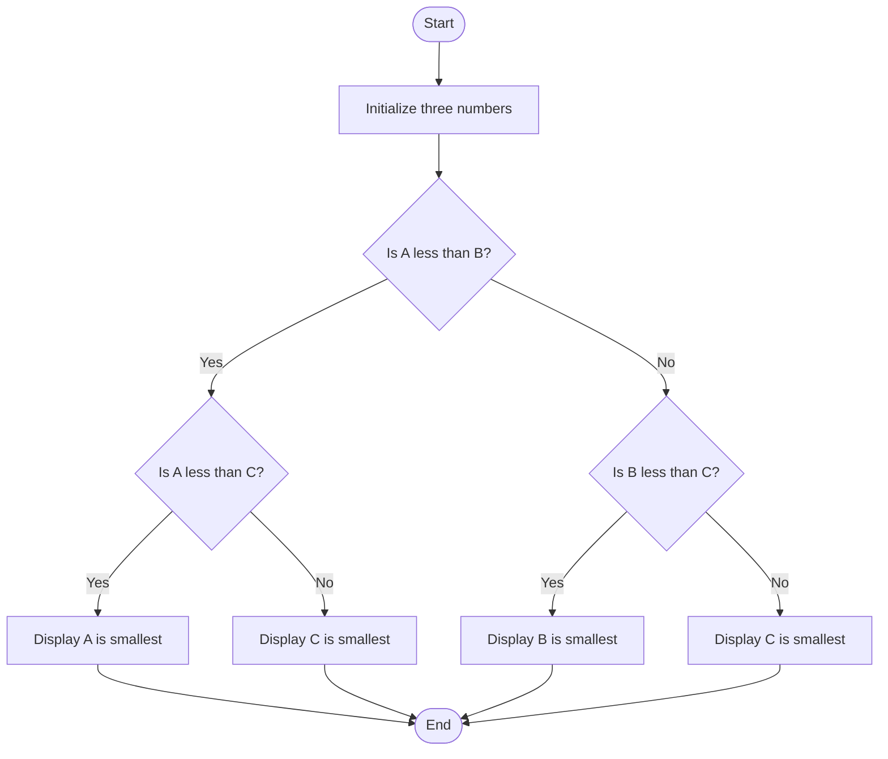
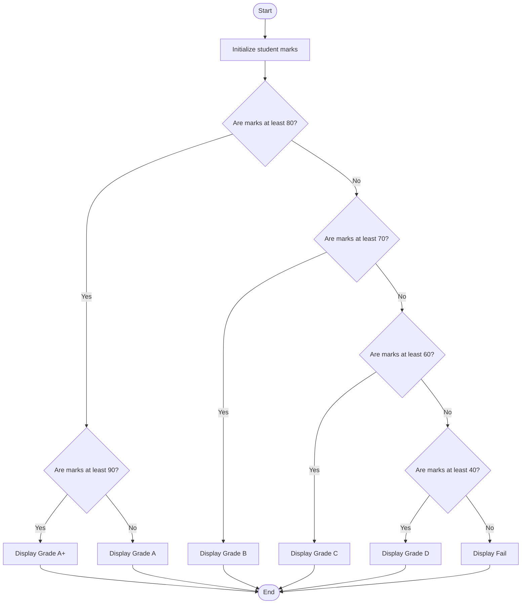

# Lab 11: Nested if Statements in C

## Program 32: Find the Largest of Three Numbers

### Question
Write a C program to find the largest of three numbers using nested if statements.

### Flowchart



### Program
**File:** 32_largest_nested_if.c

See [`32_largest_nested_if.c`](./32_largest_nested_if.c).

### Input
Predefined values: A = 10, B = 20, C = 15.

### Output
```text
B is largest
```

### Summary
This program uses nested if statements to find the largest of three numbers.

---

## Program 33: Find the Smallest of Three Numbers

### Question
Write a C program to find the smallest of three numbers using nested if statements.

### Flowchart



### Program
**File:** 33_smallest_nested_if.c

See [`33_smallest_nested_if.c`](./33_smallest_nested_if.c).

### Input
Predefined values: A = 10, B = 20, C = 5.

### Output
```text
C is smallest
```

### Summary
This program uses nested if statements to find the smallest of three numbers.

---

## Program 34: Determine a Student's Grade

### Question
Write a C program to determine a student's grade based on marks using nested if statements.

### Flowchart



### Program
**File:** 34_student_grade_nested_if.c

See [`34_student_grade_nested_if.c`](./34_student_grade_nested_if.c).

### Input
Predefined marks: 85.

### Output
```text
Grade A
```

### Summary
This program uses nested if statements to determine a student's grade based on marks.

---

## Conclusion

In this lab, we practiced nested if statements to find the largest and smallest of three numbers and determine a student's grade.
