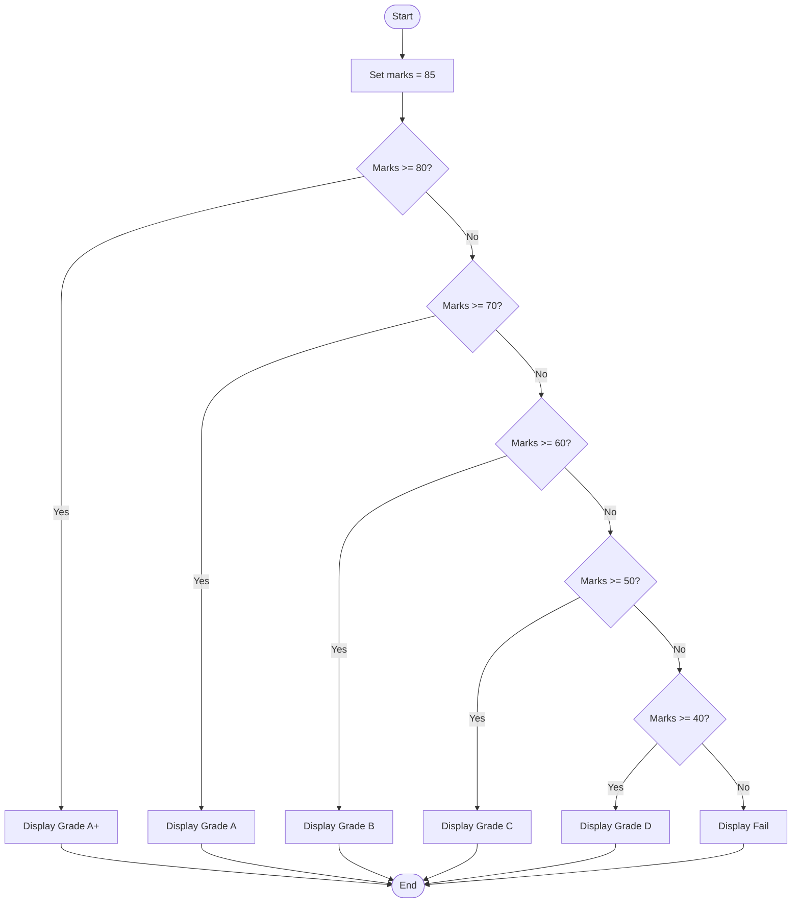
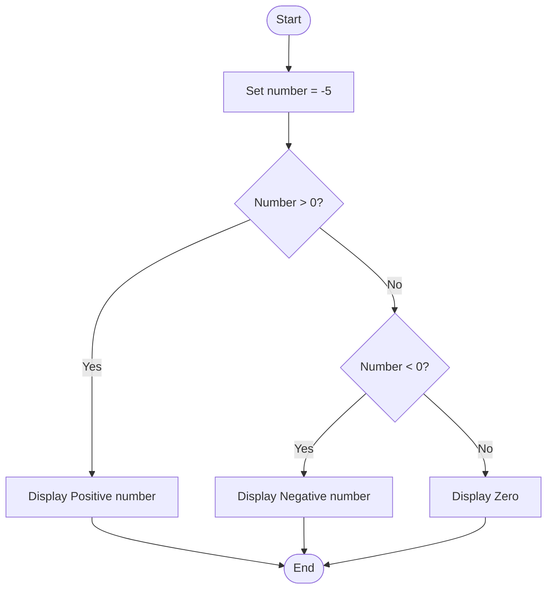
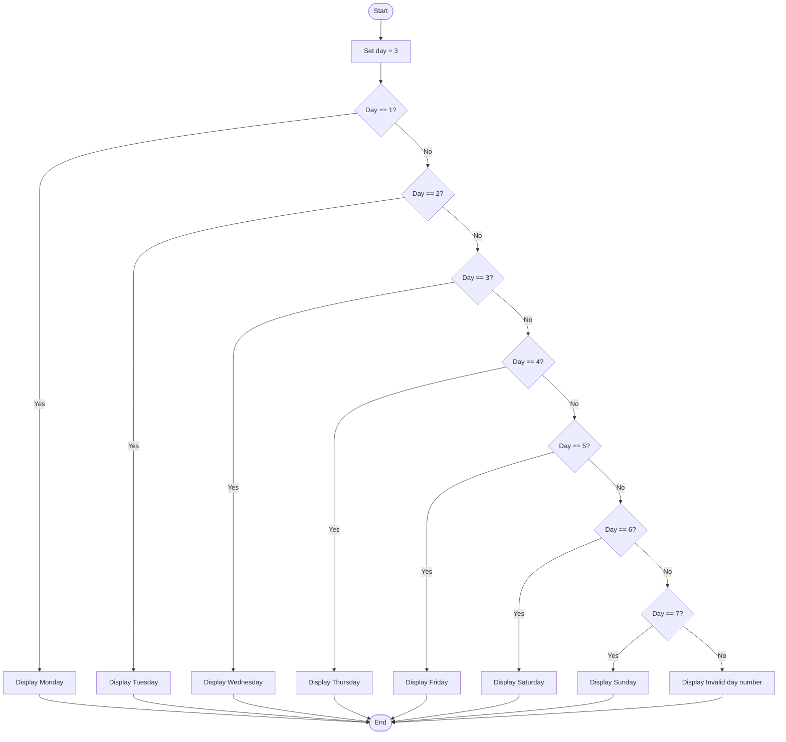

# Lab 12: Else-if Ladder

## Program 35: Determine a Student's Grade

### Question
Write a C program to determine a student's grade using an else-if ladder.

### Program File
[35_student_grade_else_if.c](./35_student_grade_else_if.c)

### Flowchart



### Input
Predefined marks: `85`

### Output
```text
Grade A+
```

### Summary
This program uses an else-if ladder to determine a student's grade based on marks. The grading thresholds are example values because the lab manual does not specify a grading scale.

---

## Program 36: Check Positive, Negative, or Zero

### Question
Write a C program to determine whether a number is positive, negative, or zero using an else-if ladder.

### Program File
[36_positive_negative_zero_else_if.c](./36_positive_negative_zero_else_if.c)

### Flowchart



### Input
Predefined number: `-5`

### Output
```text
Negative number
```

### Summary
This program uses an else-if ladder to check whether a number is positive, negative, or zero.

---

## Program 37: Display the Day of the Week

### Question
Write a C program to display the day of the week based on a number from 1 to 7.

### Program File
[37_day_of_week_else_if.c](./37_day_of_week_else_if.c)

### Flowchart



### Input
Predefined day number: `3`

Day numbering: 1 = Monday, 2 = Tuesday, 3 = Wednesday, 4 = Thursday, 5 = Friday, 6 = Saturday, 7 = Sunday.

### Output
```text
Wednesday
```

### Summary
This program uses an else-if ladder to display the corresponding day of the week for a number from 1 to 7. For any other number, it displays an invalid-day message.

---

## Lab 12 Conclusion

In this lab, we practiced using the else-if ladder in C to determine a student's grade, classify a number as positive, negative, or zero, and display the day of the week based on a number.

